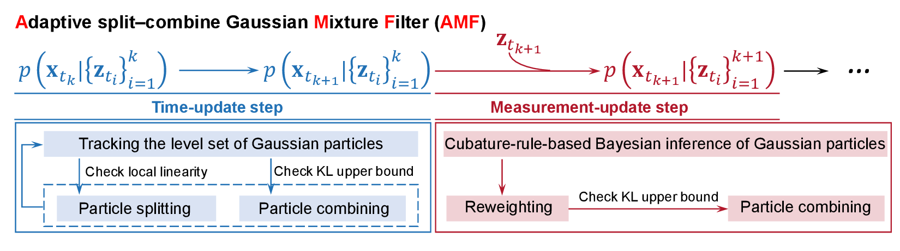
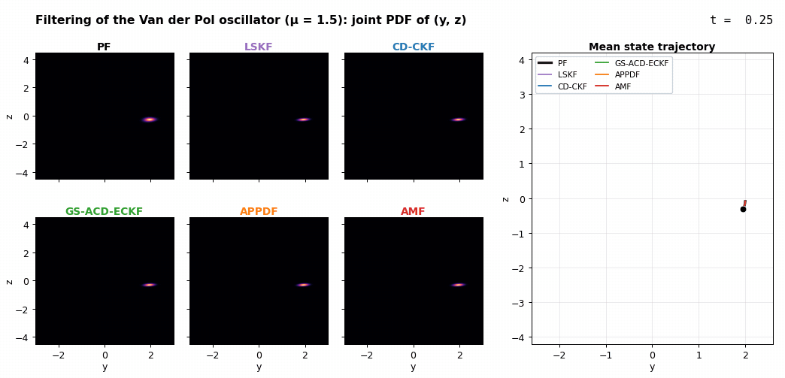
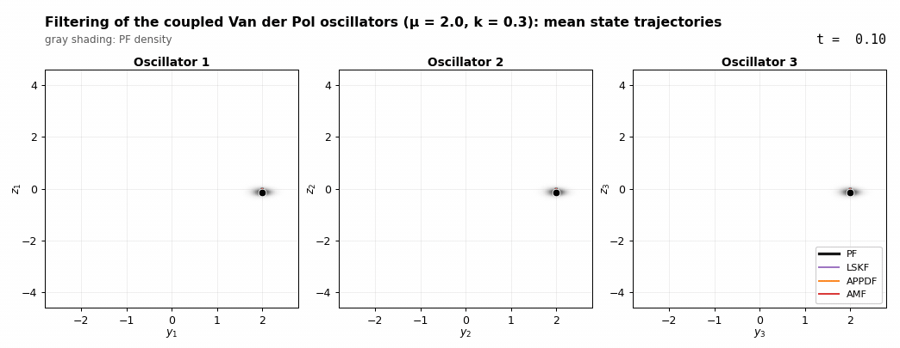
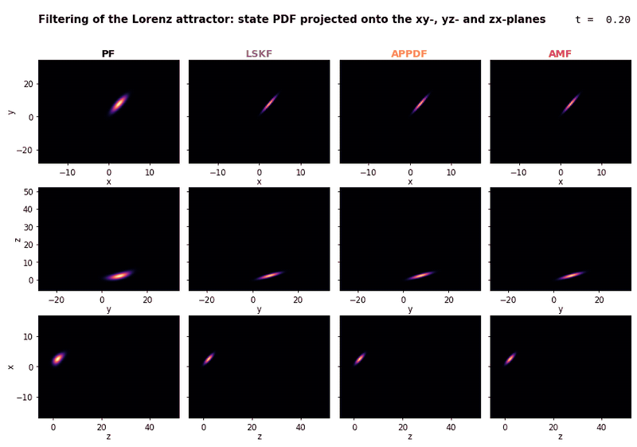

# AMF: Adaptive Split–Combine Gaussian Mixture Filter

Code for the paper *An adaptive split–combine Gaussian mixture filter for nonlinear and multimodal state
estimation* (San Kim, Won Chang, Daniel B. Forger, Dae Wook Kim).

## Contents

1. [Overview](#1-overview)
2. [Results](#2-results)
   1. [Van der Pol oscillator](#21-van-der-pol-oscillator)
   2. [Coupled Van der Pol oscillators](#22-coupled-van-der-pol-oscillators)
   3. [Lorenz attractor](#23-lorenz-attractor)
3. [Code Implementation](#3-code-implementation)
   1. [Code structure](#31-code-structure)
   2. [Installation](#32-installation)
   3. [Quick check](#33-quick-check)
   4. [Running a filter](#34-running-a-filter)
   5. [Outputs](#35-outputs)
4. [Reproducing the Paper Examples](#4-reproducing-the-paper-examples)

## 1. Overview

**AMF** (adaptive split–combine Gaussian mixture filter) is a continuous–discrete Bayesian filter that
estimates the probability density function (PDF) of the state of a nonlinear stochastic system over time
from model predictions and measurements.

In nonlinear systems with oscillatory or chaotic dynamics, the state PDF often becomes highly asymmetric
and even multimodal, which violates the single-Gaussian assumption of Kalman-type filters. Gaussian mixture
filters address this by propagating a mixture of Gaussian components, but two problems remain open:
propagating each component accurately, and adjusting the number and weights of the components over time.
Most existing methods keep the weights fixed during the time update, or solve an auxiliary optimization
problem at every time step.

AMF represents the PDF by a mixture of Gaussian particles and adjusts their number and weights with a
propagation–split–combine scheme, without any online numerical optimization (figure below). In the
time-update step, each particle is propagated by tracking its level set. A particle that violates the local
linear approximation is split into three, and particles are combined when the combined Gaussian is close
enough to their weighted sum. In the measurement-update step, the mean, covariance and weight of each
particle are updated with a cubature rule.



### Key features

- **Splitting with a guaranteed variance reduction.** A particle is split into three along a
  level-set-point direction (a column of the square-root factor of its covariance). The child particles have
  half the variance along that direction and the same covariance in the remaining directions. Their
  displacements and weights are fixed constants, so no optimization problem is solved during filtering.
- **Combining based on the Kullback–Leibler divergence.** Two particles are combined when an efficiently
  computable upper bound on the KL divergence between their mixture and the combined Gaussian is below a
  threshold, rather than when their means are close.
- **Accuracy with fewer particles.** On the benchmarks below, AMF tracks the mean and the PDF more
  accurately than the baselines, and uses fewer particles than the APPD-based filter it extends.
- **Parallel implementation.** Propagation, splitting and the measurement update are independent across
  particles, so they run in a process pool.

## 2. Results

AMF is compared with four baselines on three benchmarks. A bootstrap particle filter (PF) provides the
ground truth. The quantitative comparison is in the paper; the animations below show how each filter
tracks the state PDF and the mean state over time.

| Filter | Description |
|---|---|
| LSKF | level-set Kalman filter: a single Gaussian propagated by tracking its level set |
| CD-CKF | continuous–discrete cubature Kalman filter |
| GS-ACD-ECKF | Gaussian-sum filter with a fixed number of particles |
| APPDF | adaptive Gaussian mixture filter that splits by eigen-decomposition and combines by proximity of the particle means |
| AMF | this work |

### 2.1. Van der Pol oscillator

```math
d\begin{pmatrix} y_t \\ z_t \end{pmatrix}
= \begin{pmatrix} z_t \\ \mu (1 - y_t^2) z_t - y_t \end{pmatrix} dt + \sqrt{K}\, dW_t,
\qquad K = 0.006\, I_2
```

The state is measured at t = 10 and t = 20:

```math
\mathbf{z}_k = h(\mathbf{x}_k) + \mathbf{r}_k, \quad \mathbf{r}_k \sim \mathcal{N}(0, R),
\qquad
h(\mathbf{x}_k) = \begin{pmatrix} \sqrt{y_k^2 + z_k^2} \\ \mathrm{arctan2}(z_k, y_k) \end{pmatrix},
\quad
R = \begin{pmatrix} 0.5^2 & 0 \\ 0 & 0.8^2 \end{pmatrix}
```

The animation shows the joint PDF of (y, z) for each filter and the mean state trajectories for μ = 1.5.



### 2.2. Coupled Van der Pol oscillators

```math
d\begin{pmatrix} y_{1t} \\ z_{1t} \\ y_{2t} \\ z_{2t} \\ y_{3t} \\ z_{3t} \end{pmatrix}
= \begin{pmatrix}
z_{1t} \\
\mu (1 - y_{1t}^2) z_{1t} - y_{1t} + k (y_{2t} + y_{3t} - 2 y_{1t}) \\
z_{2t} \\
\mu (1 - y_{2t}^2) z_{2t} - y_{2t} + k (y_{1t} + y_{3t} - 2 y_{2t}) \\
z_{3t} \\
\mu (1 - y_{3t}^2) z_{3t} - y_{3t} + k (y_{1t} + y_{2t} - 2 y_{3t})
\end{pmatrix} dt + \sqrt{K}\, dW_t,
\qquad K = 0.006\, I_6
```

The state is measured at t = 5:

```math
\mathbf{z}_k = h(\mathbf{x}_k) + \mathbf{r}_k, \quad \mathbf{r}_k \sim \mathcal{N}(0, R),
\qquad
h(\mathbf{x}_k) = \begin{pmatrix}
\sqrt{y_{1,k}^2 + z_{1,k}^2} \\ \mathrm{arctan2}(z_{1,k}, y_{1,k}) \\
\sqrt{y_{2,k}^2 + z_{2,k}^2} \\ \mathrm{arctan2}(z_{2,k}, y_{2,k}) \\
\sqrt{y_{3,k}^2 + z_{3,k}^2} \\ \mathrm{arctan2}(z_{3,k}, y_{3,k})
\end{pmatrix},
\quad
R = 0.2^2\, I_6
```

The animation shows the mean state trajectories of LSKF, APPDF and AMF in the phase plane of each
oscillator for μ = 2.0 and k = 0.3, on top of the PF density.



### 2.3. Lorenz attractor

```math
d\begin{pmatrix} x_t \\ y_t \\ z_t \end{pmatrix}
= \begin{pmatrix} \sigma (y_t - x_t) \\ x_t (\rho - z_t) - y_t \\ x_t y_t - \beta z_t \end{pmatrix} dt
+ \sqrt{K}\, dW_t,
\qquad \sigma = 3,\ \rho = 26.5,\ \beta = 1,\ K = 0.4\, I_3
```

The full state is measured at t = 10:

```math
\mathbf{z}_k = \mathbf{x}_k + \mathbf{r}_k, \quad \mathbf{r}_k \sim \mathcal{N}(0,\ 0.8^2\, I_3)
```

The animation shows the state PDF of each filter projected onto the xy-, yz- and zx-planes.



## 3. Code Implementation

### 3.1. Code structure

```
.
├── vdp2d/                  # Van der Pol oscillator (2-D)
│   ├── lskf.py
│   ├── cdckf.py            # CD-CKF
│   ├── gs_acd_eckf.py      # GS-ACD-ECKF
│   ├── appdf.py
│   ├── amf.py
│   └── pf.py
├── coupled_vdp6d/          # three coupled Van der Pol oscillators (6-D)
│   ├── lskf.py
│   ├── appdf.py
│   ├── amf.py
│   └── pf.py
├── lorenz63/               # Lorenz attractor (3-D)
│   ├── lskf.py
│   ├── appdf.py
│   ├── amf.py
│   └── pf.py
├── docs/figures/           # figures shown in this README
├── README.md
└── requirements.txt
```

Every file is a self-contained script: it holds the model, the filter, and a command-line entry point, and
it does not import from the other files. Each filter is also available as a function (`run_lskf`,
`run_cdckf`, `run_gs_acd_eckf`, `run_appdf`, `run_amf`, `run_pf`) that returns the time, mean and covariance
histories.

In the code, a Gaussian particle of the paper is an instance of the class `Component`.

### 3.2. Installation

```bash
git clone https://github.com/SanKim580/AMF.git
cd AMF
conda create -n amf python=3.12
conda activate amf
pip install -r requirements.txt
pip install torch          # optional: only for `pf.py --backend torch`
pip install matplotlib     # optional: only for the plot in the quick check
```

Any Python 3.12 environment works in place of conda, for example one made with `python -m venv`. On Linux,
`pip install torch --index-url https://download.pytorch.org/whl/cpu` installs the smaller CPU-only build of
PyTorch.

The paper runs used Python 3.12, NumPy 1.26 and SciPy 1.13 on Linux. A fresh installation from
`requirements.txt` (NumPy 2.5, SciPy 1.18, pandas 3.1, PyTorch 2.15) was also checked.

APPDF, AMF and the CPU particle filter use a `multiprocessing` pool with the `fork` start method, so they
need Linux or macOS.

### 3.3. Quick check

The following runs the filtering example of the Van der Pol oscillator (μ = 1.5) with LSKF, AMF and the
particle filter. It takes about one minute with eight processes.

```bash
python vdp2d/lskf.py                    # about 1 s
python vdp2d/amf.py --workers 8         # about 35 s
python vdp2d/pf.py --backend torch      # about 15 s on a CPU; needs PyTorch
```

The mean trajectories of the three runs can then be plotted (needs matplotlib):

```python
import numpy as np
import matplotlib.pyplot as plt

fig, axes = plt.subplots(2, 1, sharex=True, figsize=(8, 5))
for name, style in [("pf", "k-"), ("lskf", "C0--"), ("amf", "C3-")]:
    out = np.load(f"results/vdp2d_{name}/covariance.npz")
    for i, ax in enumerate(axes):
        ax.plot(out["times"], out["means"][:, i], style, label=name.upper())
axes[0].set_ylabel("mean of y")
axes[1].set_ylabel("mean of z")
axes[1].set_xlabel("t")
axes[0].legend()
fig.savefig("results/vdp2d_means.png", dpi=150)
```

### 3.4. Running a filter

Each script runs the default case of its system when called without arguments:

```bash
python vdp2d/amf.py             # μ = 1.5, measurements at t = 10 and 20
python coupled_vdp6d/amf.py     # μ = 1.5, k = 0.2, measurement at t = 5
python lorenz63/amf.py          # measurement at t = 10
```

Use `--help` to list the options of a script. The most common ones are:

| Option | Applies to | Meaning |
|---|---|---|
| `--t-end`, `--dt` | all | final time and filter time step |
| `--no-measurements` | all | time update only (uncertainty propagation) |
| `--out DIR` | all | output directory (default `results/<system>_<method>`) |
| `--workers N` | APPDF, AMF, PF | maximum number of worker processes (default: all CPUs) |
| `--mu` | Van der Pol systems | nonlinearity parameter μ |
| `--k-coupling` | coupled Van der Pol | coupling parameter k |
| `--sigma`, `--rho`, `--beta`, `--gamma` | Lorenz | Lorenz parameters; the process noise is K = 2γ I₃ |
| `--tol` | APPDF, AMF | splitting threshold on the linearization error (ε_threshold) |
| `--weight-thresh` | APPDF, AMF | particles with a smaller weight are pruned (W_threshold) |
| `--kl-lambda` | AMF | combining threshold on the KL upper bound (C_threshold) |
| `--blocksize` | APPDF, AMF | edge length of the grid cells in which particles are combined; `vdp2d/` takes one value per state, e.g. `--blocksize 0.04 0.04` |
| `--kl-mu` | AMF | maximum number of particles per grid cell |
| `--n-particles`, `--seed` | PF | number of particles; random seed |
| `--backend {cpu,torch}` | PF | `cpu`: adaptive Runge–Kutta per particle in a process pool; `torch`: vectorized RK4, on a GPU if one is available |

For example, a short AMF run on eight processes and a torch particle filter for the same system:

```bash
python coupled_vdp6d/amf.py --t-end 3 --workers 8 --out results/amf_short
python coupled_vdp6d/pf.py --backend torch --out results/pf_torch
```

### 3.5. Outputs

Each run writes to its output directory:

| File | Content |
|---|---|
| `mean_trajectory.csv` | time, mean of every state, and the number of particles for the mixture filters |
| `covariance.npz` | `times` (T,), `means` (T, d), `covs` (T, d, d) |
| `components.csv` | weights, means and covariance factors of the Gaussian particles; written only with `--save-components` |
| `particles.*` | particles of the PF; written only with `--save-particles` |

For the mixture filters the mean and covariance are those of the whole mixture. For the PF they are the
weighted sample mean and covariance.

LSKF, CD-CKF and GS-ACD-ECKF store the time points t = 0, Δt, …, T. APPDF, AMF and the PF store
t = Δt, …, T, without the initial time.

## 4. Reproducing the Paper Examples

The measurement values used in the paper are built in and selected by the model parameters.

| Example | Command | Parameters |
|---|---|---|
| 1. Uncertainty propagation, Van der Pol | `python vdp2d/<method>.py --mu 1.6 --no-measurements` | μ ∈ {0.6, 0.8, …, 2.0} |
| 2. Filtering, Van der Pol | `python vdp2d/<method>.py --mu 1.5` | μ ∈ {1.0, 1.25, 1.5, 1.75, 2.0} |
| 3. Filtering, coupled Van der Pol | `python coupled_vdp6d/<method>.py --mu 2.0 --k-coupling 0.3` | μ ∈ {1.5, 2.0, 2.5}, k ∈ {0.1, 0.2, 0.3} |
| 4. Filtering, Lorenz attractor | `python lorenz63/<method>.py` | — |

The default settings are:

| | Van der Pol | Coupled Van der Pol | Lorenz |
|---|---|---|---|
| Process noise K | 0.006 I₂ | 0.006 I₆ | 0.4 I₃ |
| Initial mean | (2, 0) | (2, 0, 2, 0, 2, 0) | (1, 1, 1) |
| Initial covariance | 0.01 I₂ | 0.01 I₆ | 0.1 I₃ |
| Time step, final time | 0.05, 30 | 0.01, 10 | 0.01, 20 |
| Measurement times | 10, 20 | 5 | 10 |
| Measurement noise R | diag(0.5², 0.8²) | 0.2² I₆ | 0.8² I₃ |
| AMF splitting threshold `--tol` | 0.05 | 0.05 | 0.05 |
| AMF combining threshold `--kl-lambda` | 0.03 | 0.05 | 0.05 |
| AMF cell size `--blocksize` | 0.04 | 1.0 | 1.0 |
| PF particles | 50,000 | 300,000 | 500,000 |

For other parameter values, pass the measurements explicitly (`--measurements` in `vdp2d/`, `--measurement`
in the other two folders) or use `--no-measurements`.
